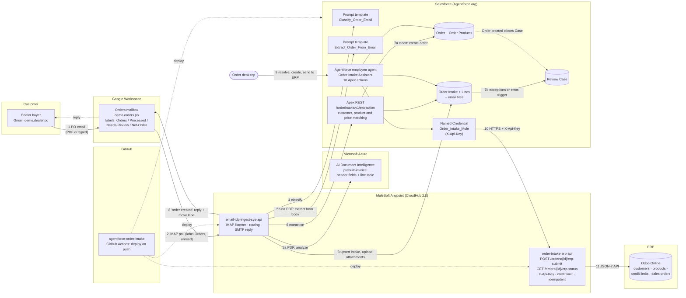
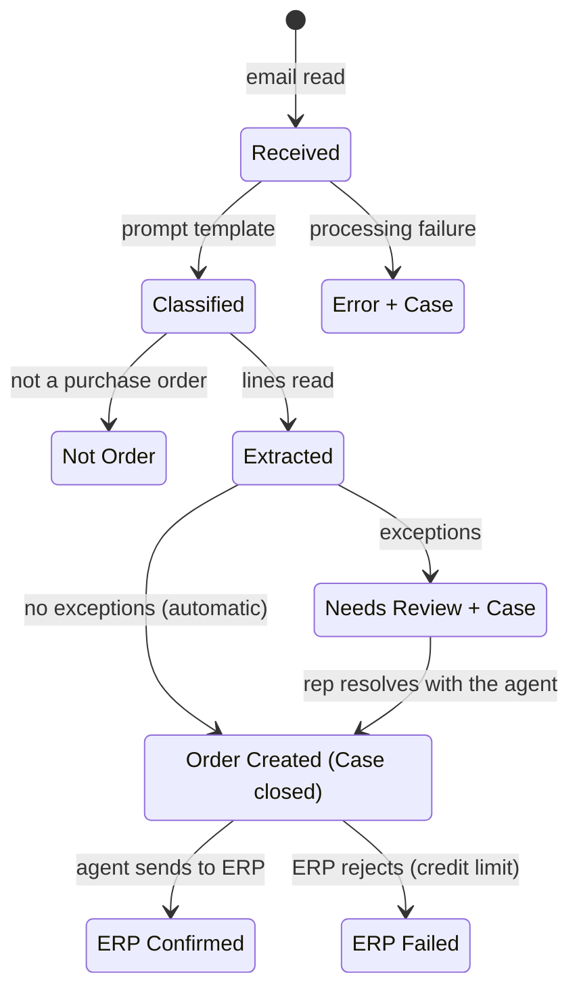
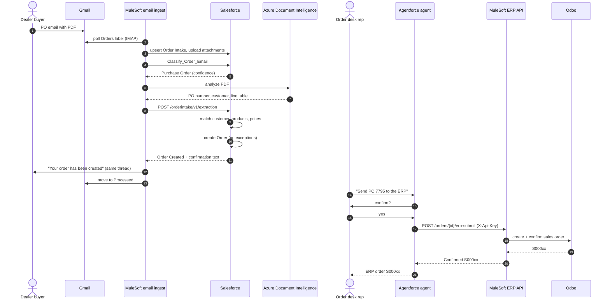

# Architecture and demo user stories

End to end: **customer email → Salesforce Order Intake → Salesforce Order → Odoo sales order**.

## 1. High-level architecture

### Components
| Layer | Component | Responsibility |
|---|---|---|
| Channel | Gmail orders mailbox | Receives POs; labels show processing state |
| Integration | `email-idp-ingest-sys-api` (Mule 4, CloudHub 2.0) | Polls Gmail, creates the intake, uploads attachments, calls classification and extraction, replies to the customer |
| AI | `Classify_Order_Email` prompt template | Purchase Order / Change Order / Inquiry / Other, with confidence and reason |
| AI | Azure AI Document Intelligence | Reads the PO PDF: PO number, customer number, line table |
| AI | `Extract_Order_From_Email` prompt template | Reads an order typed in the email body (Azure is skipped) |
| Business rules | Apex REST `/orderintake/v1/extraction` + `OrderIntakeService` | Matches customer (sender, customer number), products (SKU), list prices (5% tolerance), confidence (80%) |
| Automation | `OrderIntakeTrigger` / `OrderIntakeReviewCases` | One review Case per intake that needs review or failed; closes when the order is created |
| Agent | Order Intake Assistant (Agent Script, 3 subagents) | Finds intakes, resolves exceptions, creates orders, sends to the ERP, drafts customer emails; confirmation before every consequential step |
| Integration | `order-intake-erp-api` (Mule 4, CloudHub 2.0) | Creates and confirms the Odoo sales order; enforces credit limit; returns the existing order on resubmit |
| ERP | Odoo Online | System of record for sales orders |
| DevOps | GitHub Actions | Deploys both Mule apps and Salesforce metadata on every push to `main` |

### Status flow of an Order Intake

### End-to-end sequence (clean PO)

## 2. Demo user stories

Before the demo: reset Salesforce (`reset-demo-intakes.apex`, then `seed-demo-intakes.apex`), cancel and delete
earlier test orders in Odoo, leave no unread emails under **Orders**, and check both apps are **Running** in Runtime
Manager. Gmail filter: every email to demo.orders.po gets the **Orders** label.

Open these tabs: dealer Gmail, orders Gmail, Salesforce **Order Desk** app, Odoo **Sales**.

---

### Story 1: A clean PDF purchase order becomes an order without anyone touching it
**As a** customer buyer, **I want** to email my PO as a PDF and get a confirmation, **so that** I know my order is in.
**As an** order desk manager, **I want** clean POs processed automatically, **so that** my team only handles exceptions.

| Step | Who / where | Action | What you show |
|---|---|---|---|
| 1 | Dealer Gmail | From `+cobalt`, send to demo.orders.po: subject `PO 7795 - bolts, nuts, gaskets`, attach `PO-7795-Cobalt-clean.pdf` | The email being sent |
| 2 | Orders Gmail | Wait ~1 minute | Email under **Orders**, then it moves to **Processed** |
| 3 | Salesforce → Order Intakes | Open the newest intake | Classification **Purchase Order** (with confidence and reason), Extraction Source **PDF**, status **Order Created**, PDF under **Notes & Attachments** |
| 4 | Intake → Lines | Show the lines | BLT-3001 ×30 @ 22.00, NUT-3101 ×30 @ 9.80, GSK-4001 ×200 @ 1.35, all **Matched** |
| 5 | Intake → Order | Open the order | Salesforce order with 3 products, total 1,224.00 |
| 6 | Dealer Gmail | Open the thread | Reply: "Your order has been created as order 000001xx", lines and total |

**Acceptance:** intake *Order Created*, Salesforce order exists, customer got the reply, no Case.

---

### Story 2: An order typed in the email body is processed the same way
**As a** customer buyer, **I want** to just type my order in an email, **so that** I don't need to prepare a PDF.

| Step | Who / where | Action | What you show |
|---|---|---|---|
| 1 | Dealer Gmail | From `+cobalt`, no attachment: subject `PO 7801 - bolts and nuts`, body `Please supply 40 x BLT-3001 at 22.00 and 40 x NUT-3101 at 9.80. Customer CUST-1002.` | The email |
| 2 | Salesforce | Open the new intake | Extraction Source **email body** (Azure skipped), status **Order Created**, 2 Matched lines |
| 3 | Dealer Gmail | Open the thread | "Order created" reply, total 1,272.00 |

**Acceptance:** same result as Story 1 without a PDF.

---

### Story 3: A PO with problems is routed to a person, resolved with the agent, and sent to Odoo
**As an** order desk rep, **I want** problem orders explained to me with suggested fixes, **so that** I can resolve them in minutes.
**As a** sales manager, **I want** a Case for every order that needs attention, **so that** nothing is lost.

| Step | Who / where | Action | What you show |
|---|---|---|---|
| 1 | Dealer Gmail | From `+brightline`, send `PO 45188 - widgets, bearings and valves` with `PO-45188-Brightline-exceptions.pdf` | The email |
| 2 | Orders Gmail | Wait ~1 minute | Email moves to **Needs-Review**; no reply sent |
| 3 | Salesforce → intake | Open it | Status **Needs Review**, exceptions **Unknown SKU, Price Mismatch**; line 2 `BRG6204` Unmatched, line 3 `VLV-5001` Price Mismatch |
| 4 | Intake → Review Cases | Open the Case | Subject with PO and exceptions; description with all lines and the email; the PDF on the Case |
| 5 | Agentforce panel | *"What needs my attention today?"* | Agent lists PO 45188 with its exceptions |
| 6 | Agent | *"Show me PO 45188"* | Lines, exceptions, and "Review case: 0000xxxx (New)" |
| 7 | Agent | *"What products could line 2 be?"* | Suggests **BRG-2001 Ball Bearing 6204-2RS**; asks the rep to choose |
| 8 | Agent | *"Use BRG-2001 for line 2"* | Line 2 Matched |
| 9 | Agent | *"Accept the customer's PO price for line 3"* | Line 3 Matched; no exceptions left |
| 10 | Agent | *"Create the order"* → confirm | Order number; intake **Order Created**; Case **Closed** |
| 11 | Agent | *"Send it to the ERP"* → confirm | Odoo number **S000xx**; intake **ERP Confirmed** |
| 12 | Odoo → Sales | Open the order | Confirmed sales order for Brightline, customer reference 45188, 3 lines |
| 13 | Agent | *"Draft a confirmation email for PO 45188"* → approve | Email with the exact lines, prices and ERP number |

**Acceptance:** Case opened then closed automatically; Odoo order confirmed; customer confirmation drafted from the order data.

---

### Story 4: The ERP rejects an order over the credit limit and the agent escalates it
**As an** order desk rep, **I want** ERP rejections explained in plain words with the next step, **so that** I don't need to read ERP errors.

| Step | Who / where | Action | What you show |
|---|---|---|---|
| 1 | Agent | *"Send PO HP-2210 to the ERP"* (seeded clean intake; the agent creates the order first if needed) → confirm | Odoo rejects: total 35,920 is over the 25,000 credit limit; intake **ERP Failed** |
| 2 | Agent | *"Escalate it to the Credit team"* | Task created for Credit |
| 3 | Odoo | Sales | No order created for Harbor and Pine |

**Acceptance:** the credit limit is enforced by the ERP; the rep gets the reason and a one-step escalation.

---

### Story 5: Emails that are not orders are filtered out
**As an** order desk manager, **I want** inquiries kept out of the order queue, **so that** reps only see real orders.

| Step | Who / where | Action | What you show |
|---|---|---|---|
| 1 | Dealer Gmail | From `+summit`: `Do you have PMP-6001 pumps in stock for next week?` | The email |
| 2 | Orders Gmail | Wait ~1 minute | Email moves to **Not-Order** |
| 3 | Salesforce | Open the intake | Classification **Inquiry**, status **Not Order**, no lines, no order |

---

### Story 6 (technical): Changes deploy automatically
**As a** developer, **I want** every change on `main` deployed and tested, **so that** the demo always runs the latest code.

| Step | Where | Action | What you show |
|---|---|---|---|
| 1 | GitHub → Actions | Open the latest runs | **MuleSoft: email ingest** (8 MUnit tests), **MuleSoft: ERP API**, **Salesforce: deploy** (17 Apex tests), all green |
| 2 | Runtime Manager | Both apps | Running, with the version from Exchange |

## 3. Suggested 3-minute running order
1. Story 1 (clean PDF, straight through), 45 s
2. Story 3 steps 1–4 (exceptions and Case), 30 s
3. Story 3 steps 5–12 (agent resolves, Odoo order), 60 s
4. Story 4 (credit limit), 25 s
5. Story 2 or 5 as a closing proof point, 20 s
