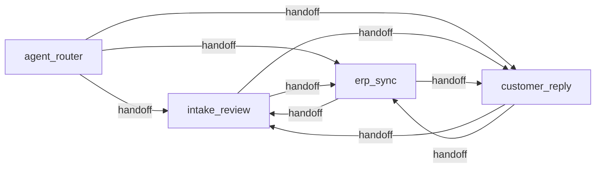

# Agent Spec: Order Intake Assistant

## Purpose and scope
An Agentforce Employee agent for order desk reps at a B2B industrial supplies distributor.
Purchase orders arrive by email (Gmail). MuleSoft reads each email, the `Classify_Order_Email`
prompt template classifies it, Azure AI Document Intelligence extracts the PO lines, and the result is
stored as an `Order_Intake__c` record with `Order_Intake_Line__c` lines. Clean POs flow straight through. The agent
handles everything that needs a person: finding intakes, resolving exceptions, creating the order,
syncing with the ERP, and replying to the customer.

Out of scope: general questions, pricing policy decisions (escalated to Pricing), credit decisions
(escalated to Credit).

## Configuration
- Agent type: `AgentforceEmployeeAgent`, active version 2
- Default agent user: N/A (employee agent runs as the signed-in rep)
- Rep permissions: `Order_Intake_User` permission set (objects, fields, app, Apex class access, agent access,
  and access to the `Order_Intake_Mule_Credential` principal used for ERP calls)
- Integration permissions: `Order_Intake_Integration` permission set for the MuleSoft run-as user
  (API access and the `/orderintake/v1/extraction` REST endpoint)
- Org: Agentforce Developer Edition, standard Orders as the stand-in for Revenue Cloud Advanced

## Behavioral intent
- Use only action results; never invent intake numbers, products, prices or ERP results.
- Resolve exceptions one line at a time. The rep picks the product for unknown SKUs; the agent never picks.
- Price mismatches (more than 5% from list) need an explicit rep decision: accept PO price, use list price, or escalate.
- Orders are created only when the customer is known and every line is Matched (enforced in Apex).
- Order creation, ERP submission and customer emails require rep confirmation (`require_user_confirmation`).
- ERP rejections are explained in plain words; credit errors are offered to the Credit team.

## Subagent map

| Subagent | Posture | Why |
|---|---|---|
| agent_router | Agentic routing | Three genuine domains with different actions and authority |
| intake_review | Mixed | Conversational exception handling; consequential order creation guarded in Apex and by confirmation |
| erp_sync | Mixed | External system writes; confirmation before submit |
| customer_reply | Mixed | Outbound email only after the rep approves exact text |

## Actions and implementations
All actions are invocable Apex in `force-app/main/default/classes`, sharing logic in `OrderIntakeService`.

| Action | Target | Inputs | Outputs (visible) | Status |
|---|---|---|---|---|
| find_order_intakes | `apex://FindOrderIntakes` | searchText, statusFilter | summary | Implemented |
| get_order_intake_details | `apex://GetOrderIntakeDetails` | intakeReference | details | Implemented |
| suggest_product_matches | `apex://SuggestProductMatches` | skuText, descriptionText | suggestions | Implemented |
| update_order_intake_line | `apex://UpdateOrderIntakeLine` | intakeReference, lineNumber, productCode, quantity, useListPrice, acceptPoPrice | message | Implemented |
| create_order_from_intake | `apex://CreateOrderFromIntake` | intakeReference | orderNumber, message | Implemented (RCA swap point) |
| check_erp_status | `apex://CheckErpStatus` | intakeReference | statusSummary | Implemented |
| submit_order_to_erp | `apex://SubmitOrderToErp` | intakeReference | erpOrderNumber, message | Implemented |
| escalate_order_intake | `apex://EscalateOrderIntake` | intakeReference, team, reason | message | Implemented |
| draft_order_confirmation_email | `apex://DraftOrderConfirmationEmail` | intakeReference | subject, body, message | Implemented |
| send_intake_customer_email | `apex://SendIntakeCustomerEmail` | intakeReference, subject, body | message | Implemented |

Confirmation emails are built in Apex from the order lines, so exact figures are never retyped by
the model. (Early testing showed 200 becoming 20: the root cause was the details text rendering
quantities in scientific notation, "2E+2", which is now fixed and covered by an Apex test.)

ERP calls go through the `Order_Intake_Mule` named credential to the MuleSoft ERP API on CloudHub
(`POST /orders/{orderId}/erp-submit`, `GET /orders/{orderId}/erp-status`). The External Credential
`Order_Intake_Mule_Credential` adds the `X-Api-Key` header (named principal `ErpApiKey`, parameter `ApiKey`;
the named credential allows formulas in headers). The request carries the approved order lines, and the
ERP API creates and confirms the sales order in Odoo, enforcing the customer's Odoo credit limit and
returning the existing Odoo order on resubmit.

If the named credential is removed, `OrderIntakeErpClient` falls back to a simulated ERP (orders above
25,000 rejected for credit limit, everything else confirmed), which keeps the agent demo usable offline.

## Variables
None. Intake references travel in conversation history; every consequential rule is enforced by the
Apex action that owns it.

## How intakes arrive
`email-idp-ingest-sys-api` (MuleSoft) creates each intake from Gmail, attaches the PDF, calls
`Classify_Order_Email`, sends purchase-order PDFs to Azure AI Document Intelligence (or, when there is no
PDF, reads the order from the email body with the `Extract_Order_From_Email` prompt template), and posts the
extraction to the Apex REST endpoint `/orderintake/v1/extraction` (`OrderIntakeExtractionApi`).
A clean intake becomes a Salesforce order straight away and MuleSoft replies "order created" to the customer
in the same thread. Every intake that is Needs Review or Error gets one review Case (`OrderIntakeTrigger`),
shown by `get_order_intake_details` and closed automatically when the rep creates the order. That
endpoint applies the same matching and exception rules as the agent (`OrderIntakeService`): customer by
sender email then customer number, products by SKU, a 5% price tolerance, and a Low Confidence flag below 80%.

## Demo scenarios
Seeded by `scripts/apex/seed-demo-intakes.apex`:

| Intake | Scenario |
|---|---|
| PO 45120 (Brightline) | Unknown SKU `BRG6204` and a 17% price mismatch on `VLV-5001` |
| PO 7781 (Cobalt) | Clean, ready to create the order and send to the ERP |
| PO HP-2210 (Harbor and Pine) | 80 pumps, total 35,920: Odoo rejects on credit limit, escalate to Credit |
| PO SMW-5530 (Summit) | Low-confidence scan with an unknown filter SKU |
| Pump availability (Summit) | Inquiry, classified Not Order |

Live by email (PDFs in `demo-purchase-orders/`): PO 45188 (Brightline, exceptions), PO 7795 (Cobalt, clean),
PO HP-2240 (Harbor and Pine, credit limit), PO SMW-5541 (Summit, faded scan).
